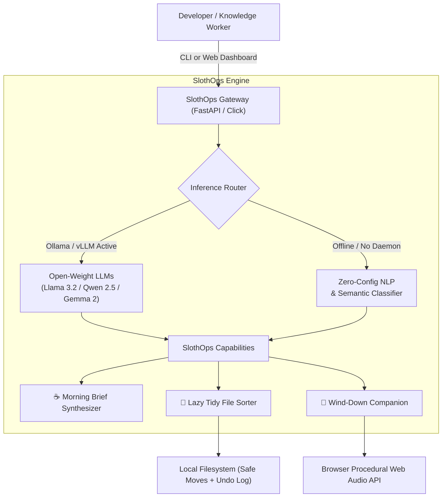

# 🦥 SlothOps — The Slow & Steady Local AI Agent

> **"Channeling the energy of a sloth: do the work so you don't have to."**  
> *Built for [Hacktoberfest 2026 Open-Source AI Challenge Week 3: Slow and Steady](https://dev.to/challenges/hacktoberfest-week3-2026-10-19).*

[](LICENSE)
[](README.md)
[](README.md)
[](pyproject.toml)

---

## 📖 Overview

In modern software development and remote work, cognitive overload is the silent productivity killer:
- Chaotic **Downloads** and desktop scratchpads overflowing with unsorted files, tax receipts, and screenshots.
- Endless messy to-do lists, open browser tabs, and frantic morning mental scrambles.
- Lingering evening anxiety about unfinished commits and unread Slack pings.

Closed AI APIs promise solutions, but at a steep price: monthly subscription fatigue, corporate data scraping, token limits, and sending sensitive personal downloads and financial receipts to remote corporate servers.

**SlothOps** is a zero-effort, local-first open-source AI agent designed to automate everyday clutter, generate calm morning digests, and guide restorative evening wind-downs—all while keeping **100% of your data private on your own machine**.

---

## 🌟 Key Features

### 1. ☕ Slow & Steady Morning Briefing
Dump your unorganized thoughts, urgent Slack pings, to-dos, or terminal scratchpads. SlothOps runs local open-weight inference (or its zero-config heuristic engine) to synthesize:
- 🎯 **Top 3 High-Impact Priorities** (What genuinely moves the needle today)
- 🦥 **Permission to Procrastinate** (Things you can safely leave for tomorrow without guilt)
- 🧘 **Sloth Wisdom of the Day** (Calming philosophical perspective)
- ⏱️ **Estimated Minutes of Stress Saved**

### 2. 🧹 "Lazy Tidy" Autonomous Clutter Sorter
Watches or scans messy folders (such as `Downloads/`, Desktop dumps, or workspace scratchpads):
- Deeply inspects filenames, extensions, and content snippets.
- Automatically organizes files into clean semantic categories: `Finance_Invoices/`, `Code_and_Dev/`, `Media_and_Design/`, `Data_and_Sheets/`, `Documents/`, and `Archives_and_Installers/`.
- **Safety First**: Full dry-run preview, collision-safe auto-renaming, and a one-click **Undo** mechanism.

### 3. 🌙 Evening Wind-Down & Procedural Ambient Soundscapes
Transition out of work mode without lingering bedtime anxiety:
- Celebrates your daily wins ("You did plenty today. Close the laptop.").
- Built-in **100% offline procedural Web Audio synthesizer**:
  - 🌧️ **Rain on Canopy** (Resonant filtered pink noise)
  - 🧘 **432Hz Warm Lo-Fi Drone** (Calming harmonic binaural sine waves)
  - 🍃 **Gentle Forest Breeze** (Bandpass modulated atmospheric wind)

### 4. ⚡ Dual AI Architecture (Zero-Config + Open Weights)
- **Open-Weight Local Inference**: Direct integration with **Ollama**, **vLLM**, or any local OpenAI-compatible endpoint running **Llama 3.2**, **Qwen 2.5**, **Gemma 2**, or **Mistral**.
- **Deterministic Heuristic Fallback**: Runs instantly on ANY machine with zero configuration—no GPU or multi-gigabyte model download required to test immediately.

---

## 🏗️ Architecture



---

## 🚀 Quickstart

### 1. Installation
Clone the repository and install dependencies:
```bash
git clone https://github.com/mohit01-beep/slothops.git
cd slothops
pip install -e .
```

### 2. Launch the Web Dashboard
```bash
python -m slothops.cli serve
```
Open **[http://127.0.0.1:8765](http://127.0.0.1:8765)** in your browser to experience the dashboard.

### 3. Using the CLI
SlothOps provides an intuitive command-line interface for your terminal routines:

```bash
# Check local model connection
slothops status

# Generate a morning brief from raw notes
slothops brief --notes "- urgent: fix auth bug - clean up downloads - read 20 tabs"

# Preview de-cluttering a folder (Dry Run)
slothops tidy ./demo_sandbox

# Execute file organization
slothops tidy ./demo_sandbox --execute

# Generate evening wind-down reflection
slothops unwind --wins "Completed SlothOps agent, merged PR #42, tested audio synthesizer"
```

---

## 💡 Why Open Innovation Matters

1. **Zero Data Leakage**: Your unfiled tax receipts, personal journals, and proprietary code snippets remain strictly on your local device.
2. **True Independence**: No closed-source API provider can deprecate your workflow, hike pricing, or throttle your rate limits.
3. **Always-On Availability**: SlothOps works on airplanes, trains, or off-grid cabins without an internet connection.
4. **Community Fine-Tuning**: Open weights allow builders to adapt small, specialized models (1B to 3B parameters) tailored to personal productivity.

---

## 🧪 Testing

SlothOps includes a comprehensive test suite covering the file sorter, fallback engine, and briefing generators:
```bash
python -m unittest discover -s tests -p "test_*.py"
```

---

## 📄 License

Distributed under the **MIT License**. See [`LICENSE`](LICENSE) for details.
