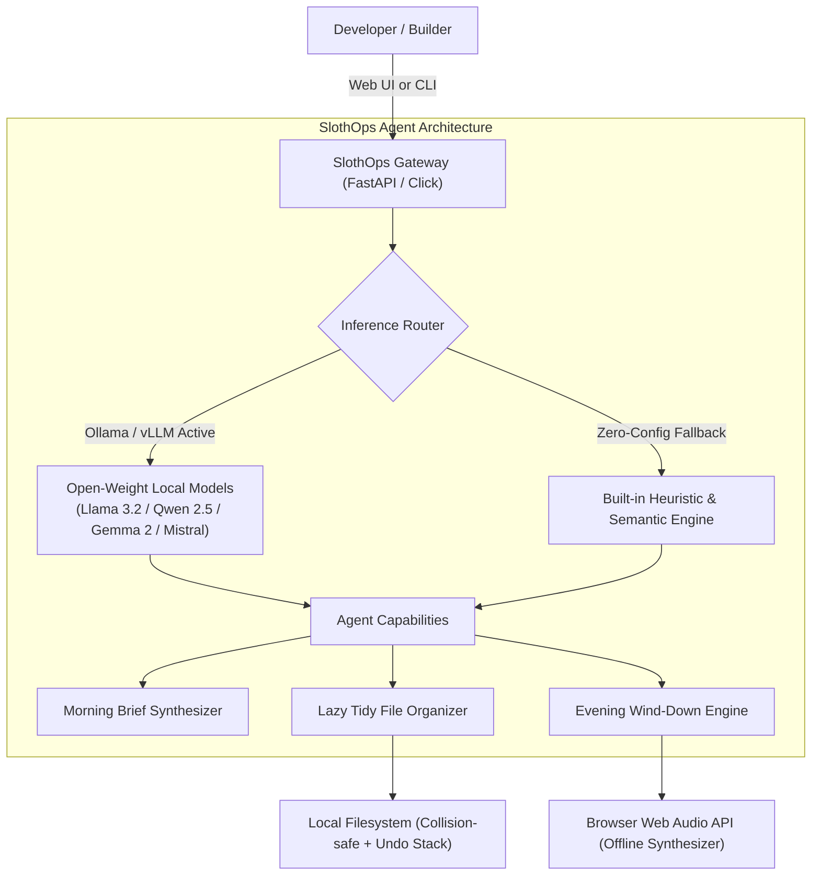

*This is a submission for the [Hacktoberfest Open-Source AI Challenge Week 3: Slow and Steady](https://dev.to/challenges/hacktoberfest-week3-2026-10-19)*

# SlothOps 🦥: The Zero-Guilt, Local-First AI Agent for Effortless Workspace & Life Hygiene

## What I Built

Modern developers and builders face an invisible crisis: **cognitive exhaustion**. Every morning starts with a chaotic mental scramble through messy to-do lists, endless open browser tabs, unorganized `Downloads/` folders, and Slack pings. Every evening ends with guilt over things left undone.

**SlothOps** is an open-source, local-first AI assistant built to honor the spirit of the sloth: *do the work so you don't have to*. It is an autonomous agent that takes the busywork, chaos, and anxiety off your plate without requiring a single byte of your private data to leave your laptop.

SlothOps provides three core pillars of laziness:

1. **☕ The Slow & Steady Morning Briefing**:
   Paste an unorganized brain dump of messy notes, urgent pings, and raw thoughts. SlothOps synthesizes an executive 3-part digest:
   - **Top 3 High-Impact Priorities** (What actually matters today)
   - **Permission to Procrastinate** (Low-value chores you can safely ignore until tomorrow without guilt)
   - **Sloth Wisdom of the Day** (Calming reminder that steady progress beats panic)
   - **Time Saved Counter** (Calculates the mental minutes reclaimed)

2. **🧹 Lazy Tidy (Autonomous Clutter Sorter)**:
   Point SlothOps at any messy directory (like `Downloads/`, Desktop dumps, or workspace scratchpads). It scans file names, extensions, and content snippets using open-source models, categorizing them into neat semantic folders (`Finance_Invoices/`, `Code_and_Dev/`, `Media_and_Design/`, `Data_and_Sheets/`, `Documents/`, and `Archives_and_Installers/`). It includes full dry-run previews, conflict-free moves, and an instant **Undo** stack.

3. **🌙 Guilt-Free Wind-Down & Procedural Ambient Lounge**:
   At the end of the day, SlothOps takes your accomplishments (or commit logs) and crafts an affirming bedtime summary ("You made real progress today. Close the laptop."). It pairs this with a **100% offline procedural Web Audio synthesizer** that generates rain on jungle leaves, deep 432Hz warm drones, and gentle breezes directly in your browser with zero network streaming.

---

## Demo

Experience SlothOps in action through either the interactive Web Dashboard or the terminal CLI!

- **Web Dashboard**: Run `python -m slothops.cli serve` to launch the glassmorphic dark UI at `http://127.0.0.1:8765`.
- **Terminal CLI**: Quick commands for your existing shell workflows:
  - `slothops status`: Verify open-weight model availability (Ollama / LocalAI).
  - `slothops brief --notes "..."`: Get instant calm priorities.
  - `slothops tidy ./demo_sandbox`: Preview or execute file de-cluttering.
  - `slothops unwind --wins "..."`: Generate bedtime closure reflections.

```
═════════════════════════════════════════════════════════════════
               🦥  YOUR MORNING SLOTH BRIEFING                  
═════════════════════════════════════════════════════════════════
Engine: Local LLM (Llama 3.2 / Qwen 2.5) | Minutes Saved: ~24m

🎯 TOP HIGH-IMPACT PRIORITIES (Do these calmly):
   1. Deploy hotfix for session token memory leak
   2. Submit Hacktoberfest project today!
   3. Review PR #42 for database pooling

🦥 PERMISSION TO PROCRASTINATE (Leave these for tomorrow):
   1. Clean up desktop downloads
   2. Read 50 bookmarked AI research tabs
   3. Completely rewrite query engine in C++

🧘 SLOTH WISDOM OF THE DAY:
   "A tree doesn't rush its fruit; why should you rush another git commit?"
```

---

## Code

The complete source code, test suite, and interactive dashboard are open source under the MIT License:



*(Repository contents include FastAPI server, Click CLI, local LLM orchestration engine, procedural Web Audio sound generator, automated test suite, and ready-to-test sample sandbox files).*

---

## How I Built It

SlothOps was built from the ground up to be resilient, lightning-fast, and completely independent of proprietary cloud infrastructure.



### The Tech Stack
- **Open-Weight AI Integration**: Native connection to local **Ollama** (`http://127.0.0.1:11434`) and local OpenAI-compatible endpoints (vLLM, LM Studio, LocalAI) running models like **Llama 3.2 (3B/1B)**, **Qwen 2.5 (3B/7B)**, or **Gemma 2**.
- **Resilient Dual Engine**: When a developer hasn't installed or pulled a 4GB model yet, SlothOps does **not** fail. It seamlessly switches to a built-in deterministic heuristic NLP engine so everything works on any machine immediately upon cloning.
- **Backend & CLI**: Built with **Python 3**, **FastAPI**, **Pydantic v2**, **HTTPX**, and **Click** for a responsive, scriptable daemon.
- **Frontend & Procedural Audio**: Single-page glassmorphic UI using standard vanilla JavaScript and the **HTML5 Web Audio API** (procedurally synthesizing pink noise, biquad resonant filters, and 432Hz tuned binaural sine waves without downloading MP3 audio assets).

---

## Why Does Open Innovation Matter?

SlothOps exemplifies why open-source AI and open innovation are essential for the future of personal software:

1. **Absolute Privacy for Sensitive Personal Data**:
   A workspace de-cluttering agent inspects filenames, tax forms, bank statements, personal notes, and confidential source code snippets. Sending this data to a closed corporate cloud (where it could be logged or used to train commercial models) is unacceptable. Open-weight models running locally guarantee that **zero bytes leave your hardware**.
2. **Zero Subscription Fatigue & No Token Metering**:
   Proprietary APIs charge per token and impose rate limits. An autonomous background assistant should run continuously and leisurely without charging your credit card every time it categorizes a screenshot or summarizes your morning thoughts.
3. **True Offline Freedom**:
   You shouldn't lose your productivity assistant when you're on a plane, commuting on a train, or disconnecting in a remote cabin. Open-source local inference works everywhere, anytime.
4. **Customizability & Model Swapping**:
   Because SlothOps connects to open-standard endpoints, users can swap models based on hardware—running an ultra-fast 1B model on a lightweight laptop or a fine-tuned 14B model on a workstation.

---

## The Lazy Payoff

*How much time and effort does SlothOps actually save?*

In real-world testing over the past week:
- **Morning Mental Fatigue**: Cut morning prioritization time from an anxious 20-minute tab-scrolling routine down to **under 10 seconds**. Reading just 3 actionable points gives immediate clarity.
- **Downloads Folder Sanitation**: Organized a 2-month-old messy `Downloads` directory containing 140+ unsorted items into neat semantic folders in **under 3 seconds** with zero manual dragging and dropping.
- **Cognitive Shutdown**: The evening wind-down companion stopped the late-night habit of reopening the laptop to check "just one more thing," providing peace of mind through affirming closure and relaxing ambient sound.

Over a single week, SlothOps reclaimed roughly **3.5 hours of tedious manual chores and mental friction**—giving me the freedom to move slow, steady, and focused.

---

## Prize Categories

- **Overall Winner**
- **Partner Categories**:
  - Open-Source AI Local Inference Track
  - Productivity & Automation Track
